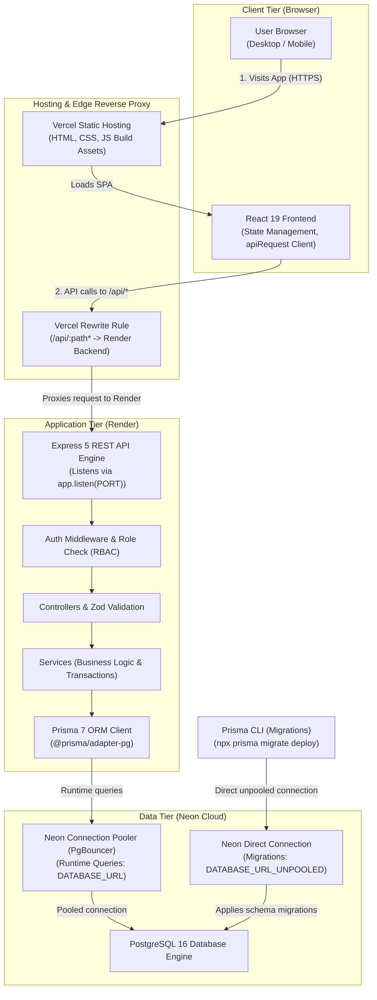
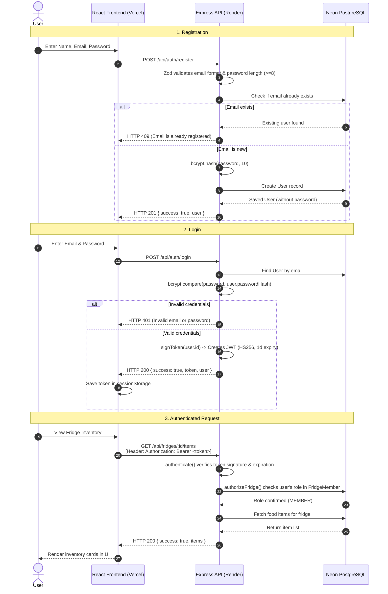
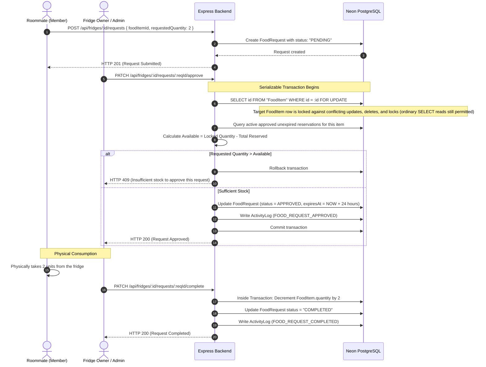
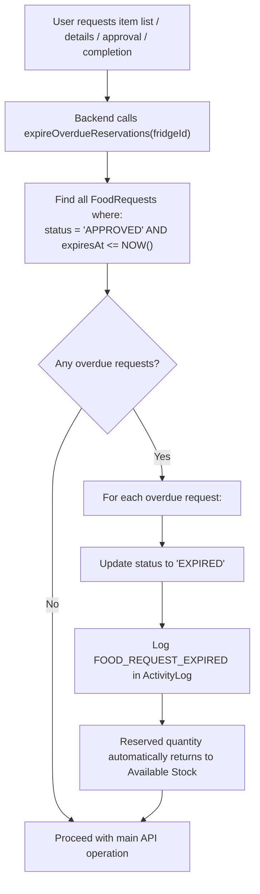

# FridgePolice — High-Level Design (HLD)

**Project Name:** FridgePolice
**Document Version:** 2.0 (Viva Edition)
**Target Audience:** Students, Viva Examiners, Project Reviewers
**Live Frontend:** [https://fridge-police.vercel.app](https://fridge-police.vercel.app)
**Backend API:** [https://fridge-police.onrender.com](https://fridge-police.onrender.com)

---

## 1. System Architecture Overview

FridgePolice uses a clean, standard three-tier architecture:

1. **Presentation Tier (Frontend):** A Single Page Application (SPA) built with React 19 and Vite 8, hosted on Vercel.
2. **Application Tier (Backend):** A REST API built with Node.js and Express 5, hosted as a containerized web service on Render.
3. **Data Tier (Database):** A PostgreSQL 16 database hosted on Neon, accessed through Prisma ORM 7.

---

## 2. Responsibilities of Each Component

### 2.1 Frontend (React 19 + Vite 8)
- Renders the user interface and handles all user interactions.
- Manages client-side state using React's `useState` hook (current view, active fridge, open modals, dark mode).
- Uses `useEffect` to fetch data from the backend when components mount or when the active fridge changes.
- Stores the active authentication token in browser `sessionStorage` (`fridgepolice_token`).
- Sends all API requests through a central helper (`src/lib/api.js`) that automatically attaches the `Authorization: Bearer <token>` header.
- Displays friendly loading states, error banners, and toast notifications.

### 2.2 Backend (Node.js + Express 5)
- Defines RESTful API routes for authentication, fridges, inventory, requests, discovery, and user stats.
- Validates all incoming request bodies and query parameters with Zod schemas before running business logic.
- Verifies JWT tokens and attaches the authenticated user's ID to `req.user`.
- Checks per-fridge role authorization (`OWNER`, `ADMIN`, `MEMBER`) via the `authorizeFridge` middleware.
- Runs business logic inside services, managing database transactions (`prisma.$transaction`) and concurrency locks (`SELECT ... FOR UPDATE`).
- Centralizes error handling so clients receive clean, predictable JSON error responses.
- Listens using `app.listen(PORT)` (port provided by Render via `process.env.PORT`, or port 5000 in local development).

### 2.3 Database (Neon PostgreSQL 16 + Prisma ORM)
- Stores all relational data across tables: `User`, `Fridge`, `FridgeMember`, `FoodItem`, `FoodRequest`, `MembershipRequest`, and `ActivityLog`.
- Guarantees data integrity using foreign keys and cascade delete rules.
- Prisma ORM generates type-safe query methods for application services.
- Database schema migrations are executed through Prisma CLI commands (`prisma migrate dev` / `prisma migrate deploy`), not by the running Express application.
- Uses Neon's connection pooling (PgBouncer) via `DATABASE_URL` for standard web requests, preventing connection exhaustion under concurrent traffic.
- Uses a direct unpooled connection via `DATABASE_URL_UNPOOLED` for Prisma CLI migrations so PostgreSQL migration advisory locks function properly. Note that PgBouncer and the direct connection are distinct access routes to the PostgreSQL 16 database engine.

---

## 3. How the Frontend and Backend Communicate

A key engineering decision in FridgePolice is **how API requests travel from the browser to the backend**:

- In development: The frontend runs at `http://localhost:5173`. `vite.config.js` proxies `/api` to `http://localhost:5000`.
- In production: The frontend is at `https://fridge-police.vercel.app`. It makes requests to relative paths like `/api/auth/login` and `/api/fridges`.
- `vercel.json` rewrites all `/api/:path*` requests to `https://fridge-police.onrender.com/api/:path*`.
- **Why this is important:** Because the browser communicates directly with `https://fridge-police.vercel.app`, requests remain strictly **same-origin**. There is no need for complex Cross-Origin Resource Sharing (CORS) configurations, and headers and JSON payloads are forwarded seamlessly.

---

## 4. Authentication Flow

---

## 5. Food Portion Request Workflow & Concurrency Protection

This workflow demonstrates how FridgePolice prevents two roommates from taking the same item at the same time:

---

## 6. Stale Reservation Expiry Workflow (Lazy Evaluation)

Instead of running an expensive background timer or cron process, FridgePolice uses **deterministic lazy expiration**:

---

## 7. Public Discovery & Membership Join Workflow

1. A fridge owner enables `isDiscoverable = true` and `acceptJoinRequests = true` in fridge settings.
2. A visitor visits the Discover tab. The backend runs `GET /api/discover/fridges`, returning a safe public projection (name, description, member count if enabled). Private emails and internal member lists are never included.
3. The logged-in user clicks "Request to Join" (`POST /api/fridges/:id/join-requests`).
4. The fridge Owner or Admin sees the incoming application in their Requests tab.
5. Upon approval (`PATCH /api/fridges/:id/join-requests/:reqId/approve`), a database transaction adds the user as a `MEMBER` in the `FridgeMember` table and updates the request status to `APPROVED`.

---

## 8. Deployment Architecture

| Tier | Host | Details |
| :--- | :--- | :--- |
| **Frontend** | **Vercel** | - Built from Git repository root using `npm run build` (`vite build`). - Outputs static assets to `dist/`. - `vercel.json` proxies `/api/*` requests to the Render backend URL. |
| **Backend** | **Render** | - Containerized Node.js Web Service. - Root directory: `server`. - Build command: `npm install && npm run db:generate`. - Start command: `npm start`. - Server listens via `app.listen(PORT)` using `process.env.PORT` assigned by Render. - Health check path: `/api/health`. |
| **Database** | **Neon** | - Serverless PostgreSQL 16 in cloud. - `DATABASE_URL` connects through PgBouncer for runtime connection pooling. - `DATABASE_URL_UNPOOLED` connects directly for running schema migrations via Prisma CLI. - Note: Express does not run migrations. |
