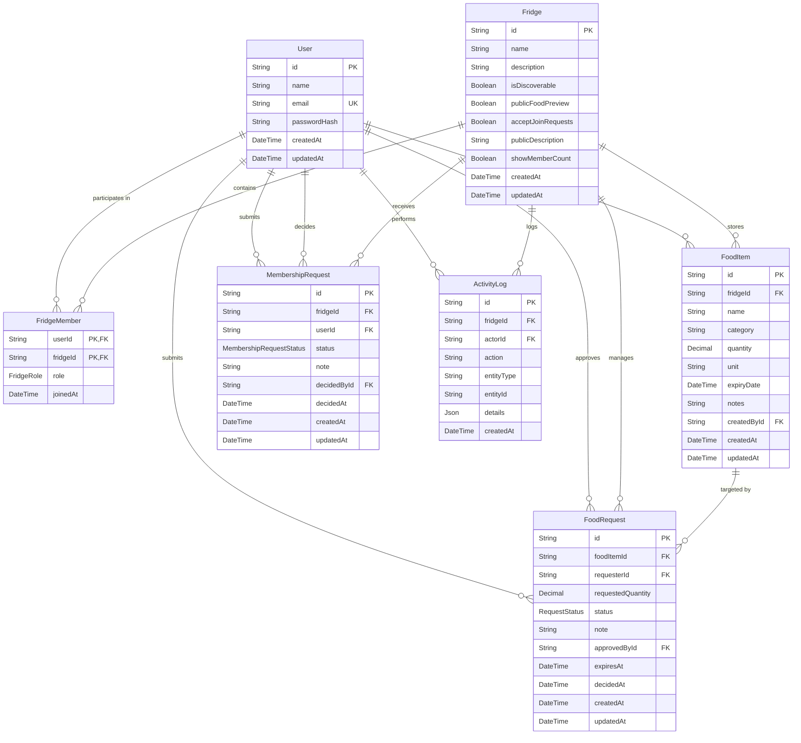
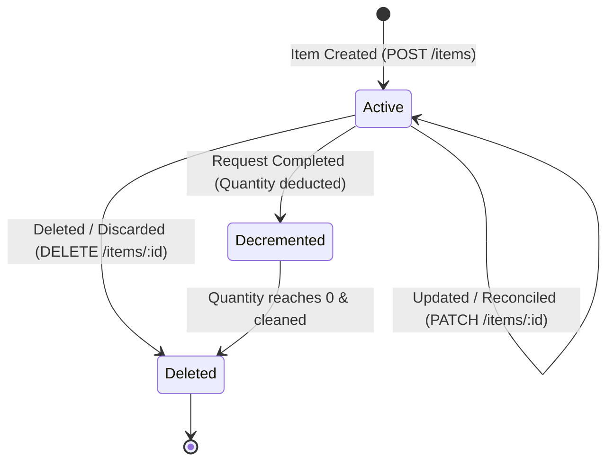
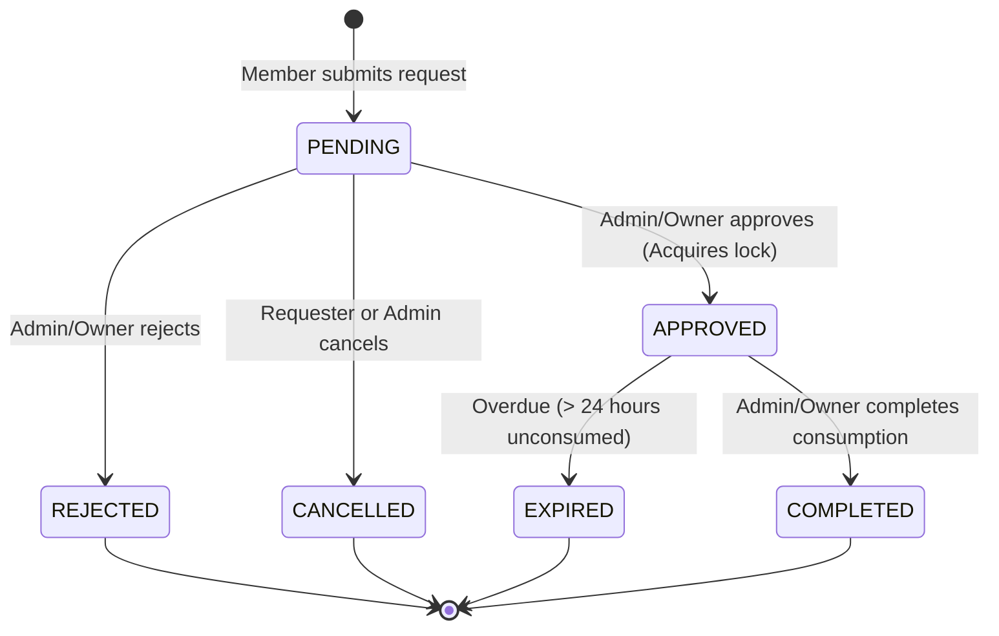
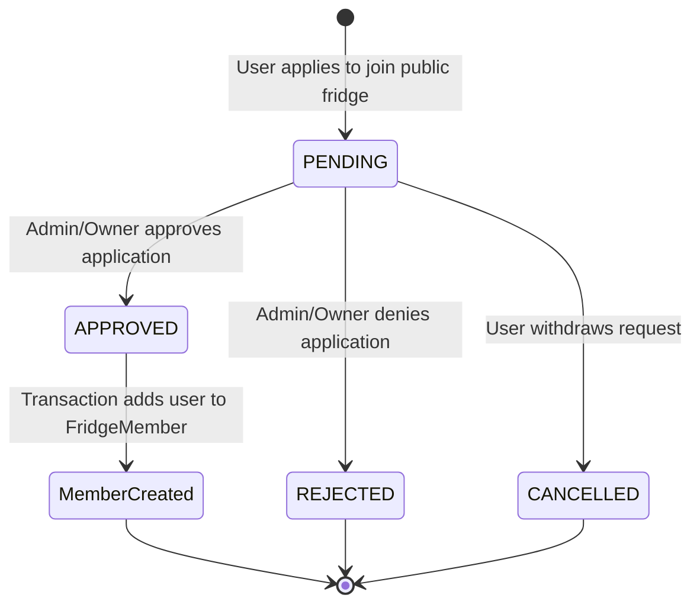

# FridgePolice — Low-Level Design (LLD)

**Project Name:** FridgePolice  
**Document Version:** 1.0.0  
**Target Audience:** Software Engineers, Backend Developers, Security Reviewers, QA Engineers  
**Repository:** [https://github.com/bhavanaaa-1/fridge-police](https://github.com/bhavanaaa-1/fridge-police)  

---

## 1. Frontend Modules and Responsibilities

The client-side application is located in `src/` and built with React 19 and Vite 8:

```
src/
|-- App.jsx                  # Root shell: global state, view routing, modals, toasts
|-- App.css / index.css      # Design tokens, typography, dark mode CSS variables
|-- main.jsx                 # React root bootstrap
|-- assets/                  # Hero branding and SVG assets
|-- components/
|   |-- ActivityFeed.jsx     # Chronological audit log timeline
|   |-- CreateFridgeModal.jsx# Modal to provision new fridge workspace
|   |-- Discover.jsx         # Community discovery directory & join application
|   |-- HomeDashboard.jsx    # Overview dashboard, stats, expiring items, quick actions
|   |-- Icons.jsx            # Handcrafted Lucide-style SVG icon library
|   |-- MyFridges.jsx        # Multi-fridge switcher & role display
|   |-- MyRequests.jsx       # Tabbed requests manager (Submitted vs. To Review)
|   |-- Navigation.jsx       # Responsive sidebar, user profile badge, dark mode toggle
|   `-- Settings.jsx         # Fridge privacy, discovery, and member settings
`-- lib/
    `-- api.js               # Unified HTTP client, token management, error formatting
```

### 1.1 State Management & View Transitions (`src/App.jsx`)
- **Session State:** Coordinates `user` and `token` state read from `sessionStorage`. On startup or reload, triggers `GET /api/auth/me` to validate session health.
- **Active Context:** Maintains `activeFridgeId`. Automatically defaults to the user's first joined fridge or triggers a welcome screen if none exists.
- **Toast Notifications:** Centralized `showToast(message, type)` mechanism providing visual feedback for user actions and error alerts.
- **Theme Switcher:** Toggles `.dark` class on `document.documentElement` and persists preference in `localStorage`.

### 1.2 Unified API Client (`src/lib/api.js`)
- `getToken()`: Retrieves `fridgepolice_token` from `sessionStorage`.
- `setToken(token)`: Stores token or removes it if null/undefined.
- `clearToken()`: Wipes `sessionStorage`.
- `apiRequest(path, options)`: Wrapper around `fetch()`. Automatically injects `Authorization: Bearer <token>` when present. Intercepts HTTP 401 to clear local session and dispatch session expiration errors. Formats structured error objects containing `error.fieldErrors` when Zod validation errors occur.

---

## 2. Backend Routes, Controllers, and Services

The backend source code resides in `server/src/`:

```
server/src/
|-- app.js                       # Express app configuration & middleware pipeline
|-- server.js                    # HTTP server entry point & startup validation
|-- lib/
|   `-- prisma.js                # Singleton Prisma client with @prisma/adapter-pg
|-- middleware/
|   |-- authenticate.js          # JWT verification & optional auth middleware
|   |-- authorizeFridge.js       # Per-fridge role authorization (RBAC)
|   |-- errorHandler.js          # Centralized error handler & Zod formatter
|   `-- notFound.js              # 404 handler for unmatched routes
|-- routes/
|   |-- auth.routes.js           # /api/auth
|   |-- discover.routes.js       # /api/discover/fridges
|   |-- fridge.routes.js         # /api/fridges
|   |-- health.routes.js         # /api/health
|   |-- inventory.routes.js      # /api/fridges/:fridgeId/items
|   |-- request.routes.js        # /api/fridges/:fridgeId/requests
|   `-- user.routes.js           # /api/users
|-- controllers/
|   |-- auth.controller.js       # Authentication endpoints
|   |-- fridge.controller.js     # Fridge, member, activity, and discovery endpoints
|   |-- health.controller.js     # Health check endpoint
|   |-- inventory.controller.js  # Inventory CRUD endpoints
|   `-- request.controller.js    # Food request lifecycle endpoints
|-- services/
|   |-- auth.service.js          # Password hashing, user creation, token signing
|   |-- fridge.service.js        # Fridge business logic & discovery projections
|   |-- inventory.service.js     # Inventory CRUD & audit logging
|   `-- request.service.js       # Concurrency locks, approvals, auto-expiry, completions
|-- utils/
|   `-- token.js                 # JWT sign and verify utilities
`-- validators/
    |-- auth.validator.js        # Zod schemas for login and registration
    |-- fridge.validator.js      # Zod schemas for fridge, settings, join requests
    |-- inventory.validator.js   # Zod schemas for inventory items
    `-- request.validator.js     # Zod schemas for food portion requests
```

---

## 3. Middleware Specifications

### 3.1 Authentication Middleware (`server/src/middleware/authenticate.js`)
- **`authenticate(req, res, next)`:**
  1. Inspects `req.headers.authorization`.
  2. Extracts `scheme` and `token`. Requires format `Bearer <token>`.
  3. Verifies token via `verifyToken(token)`.
  4. Confirms existence of subject claim (`payload.sub`).
  5. Sets `req.user = { id: payload.sub }` and calls `next()`.
  6. On missing/invalid/expired token: halts pipeline with HTTP 401 `{ success: false, message: "Authentication required" }`.
- **`optionalAuthenticate(req, res, next)`:**
  - Extracts and verifies token if provided, populating `req.user`. If token is absent or malformed, sets `req.user = null` without throwing 401. Used on public discovery endpoints so authenticated users can see their own relationship to a public fridge.

### 3.2 Role-Based Authorization Middleware (`server/src/middleware/authorizeFridge.js`)
- Factory function: `authorizeFridge(allowedRoles = [])`
  - Validates `req.user?.id` (HTTP 401 if missing).
  - Validates `req.params.fridgeId` (HTTP 400 if missing).
  - Queries `prisma.fridgeMember.findUnique({ where: { userId_fridgeId: { userId, fridgeId } } })`.
  - Checks if user's role is in `allowedRoles` (e.g., `["OWNER", "ADMIN"]`).
  - If unauthorized or not a member: halts with HTTP 403 `{ success: false, message: "You do not have permission to perform this action" }`.
  - Attaches verified role to `req.fridgeRole` and calls `next()`.

### 3.3 Error Handling Middleware (`server/src/middleware/errorHandler.js`)
- Catches errors forwarded via `next(err)`:
  - **Zod Validation Errors (`err.name === "ZodError"`):** Responds with HTTP 400 `{ success: false, message: "Invalid request data", errors: err.errors }`.
  - **Explicit Domain Errors:** Uses `err.statusCode` or `err.status` (e.g., 404, 409).
  - **Unhandled Exceptions:** Maps to HTTP 500 `{ success: false, message: "Internal server error" }`, logging full stack trace on the server while redacting internal details from the client response.

---

## 4. Authentication Implementation

- **Password Hashing:** `bcryptjs.hash(password, 10)` generates a 60-character salted hash with 10 rounds of key stretching. Plaintext passwords are never stored or logged.
- **Password Verification:** `bcryptjs.compare(password, user.passwordHash)`. Constant-time comparison prevents timing attacks.
- **Token Generation (`server/src/utils/token.js`):**
  - Uses `jsonwebtoken.sign(payload, secret, options)`.
  - Payload: `{ sub: user.id }`.
  - Algorithm: `HS256`.
  - Secret: `process.env.JWT_SECRET` (validated at server boot to ensure minimum length $\ge 32$ characters).
  - Expiry: `process.env.JWT_EXPIRES_IN` (defaults to `1d`).

---

## 5. Database Entities and Relationships



### 5.1 Referential Integrity & Cascades
- `FridgeMember`: Cascades on `User` delete and `Fridge` delete (`onDelete: Cascade`).
- `FoodItem`: Cascades on `Fridge` delete (`onDelete: Cascade`); restricts on `User` delete (`onDelete: Restrict`) to preserve inventory history.
- `FoodRequest`: Cascades on `FoodItem` delete and `requester` delete (`onDelete: Cascade`); sets null on `approvedBy` delete (`onDelete: SetNull`).
- `MembershipRequest`: Cascades on `Fridge` and `User` delete (`onDelete: Cascade`); sets null on `decidedBy` delete (`onDelete: SetNull`).
- `ActivityLog`: Cascades on `Fridge` delete (`onDelete: Cascade`); sets null on `actor` delete (`onDelete: SetNull`).

---

## 6. Request and Response Validation Schemas

All incoming request parameters and payloads are validated via Zod schemas:

| Schema | File Path | Validation Rules |
| :--- | :--- | :--- |
| `registerSchema` | `validators/auth.validator.js` | `name`: trim, min 1; `email`: trim, lowercase, RFC email; `password`: min 8 chars. |
| `loginSchema` | `validators/auth.validator.js` | `email`: trim, lowercase, RFC email; `password`: min 1 char. |
| `createFridgeSchema`| `validators/fridge.validator.js`| `name`: trim, min 1; optional boolean flags for discoverability and previews. |
| `updateFridgeSettingsSchema` | `validators/fridge.validator.js` | Optional updates to discoverability, join requests, public description ($\le 1000$ chars). |
| `addMemberSchema` | `validators/fridge.validator.js` | `email`: valid email; `role`: enum `["ADMIN", "MEMBER"]`. |
| `createItemSchema` | `validators/inventory.validator.js` | `name`: min 1; `quantity`: positive number $> 0$; `unit`: min 1; optional date. |
| `updateItemSchema` | `validators/inventory.validator.js` | Partial update; at least one field required; positive quantity if supplied. |
| `createRequestSchema` | `validators/request.validator.js` | `foodItemId`: string; `requestedQuantity`: positive number $> 0$; optional note. |
| `listRequestsQuerySchema` | `validators/request.validator.js` | Optional `status` filter; optional pagination `page`, `limit` ($\le 100$). |

---

## 7. Inventory Lifecycle



1. **Creation:** Admin/Owner posts item details. An atomic transaction creates `FoodItem` and writes `INVENTORY_ITEM_CREATED` to `ActivityLog`.
2. **Querying:** Paginated list with case-insensitive search (`contains`, `mode: "insensitive"`) and category filtering.
3. **Physical Reconciliation (Update):** Admin/Owner adjusts quantity or details. Writes `INVENTORY_ITEM_UPDATED` with `updatedFields` recorded in `ActivityLog.details`.
4. **Physical Reconciliation (Deletion):** Discarding spoiled food or removing empty records calls `DELETE /api/fridges/:id/items/:itemId`. Writes `INVENTORY_ITEM_DELETED` to `ActivityLog`.

---

## 8. Food Request Lifecycle & Concurrency Locking



### 8.1 Concurrency Locking Mechanism (`approveRequest` in `request.service.js`)
When an Admin/Owner approves a request:
```javascript
// Step 1: Run lazy expiration to sweep stale reservations
await expireOverdueReservations(fridgeId);

// Step 2: Attempt approval within a Serializable transaction
const attemptApproval = async () => {
  return prisma.$transaction(
    async (tx) => {
      // Step 2a: Locate request
      const request = await tx.foodRequest.findFirst({ ... });
      if (request.status !== "PENDING") throw new Error("Only pending requests can be approved");

      // Step 2b: PESSIMISTIC ROW LOCK on the FoodItem
      await tx.$queryRaw`SELECT id FROM "FoodItem" WHERE id = ${request.foodItemId} FOR UPDATE`;

      // Step 2c: Read locked current stock
      const lockedItem = await tx.foodItem.findUnique({
        where: { id: request.foodItemId },
        select: { quantity: true },
      });

      // Step 2d: Aggregate active, unexpired approved reservations
      const activeReservations = await tx.foodRequest.findMany({
        where: {
          foodItemId: request.foodItemId,
          status: "APPROVED",
          expiresAt: { gt: new Date() },
          id: { not: requestId },
        },
        select: { requestedQuantity: true },
      });

      const reserved = activeReservations.reduce(
        (sum, r) => sum.plus(r.requestedQuantity),
        new Prisma.Decimal(0)
      );

      const available = lockedItem.quantity.minus(reserved);

      // Step 2e: Enforce stock availability
      if (request.requestedQuantity.greaterThan(available)) {
        const error = new Error("Insufficient stock to approve this request");
        error.status = 409;
        throw error;
      }

      // Step 2f: Update status & set 24h expiration timestamp
      const updated = await tx.foodRequest.update({
        where: { id: requestId },
        data: {
          status: "APPROVED",
          approvedById: userId,
          decidedAt: new Date(),
          expiresAt: new Date(Date.now() + 24 * 60 * 60 * 1000),
        },
      });

      await tx.activityLog.create({ ... action: "FOOD_REQUEST_APPROVED" });
      return updated;
    },
    { isolationLevel: "Serializable" }
  );
};
```
- **Serialization Conflict Retry:** If two transactions simultaneously attempt serializable execution, PostgreSQL throws code `P2034`. The service wraps this in a 3-attempt loop:
  ```javascript
  for (let attempt = 0; attempt < 3; attempt++) {
    try {
      return await attemptApproval();
    } catch (error) {
      if (error?.code === "P2034" && attempt < 2) continue;
      throw error;
    }
  }
  ```

---

## 9. Membership Request Lifecycle



- **Submission:** Prospective member submits `POST /api/fridges/:id/join-requests`.
- **Duplicate Prevention:** Verified via query; throws HTTP 409 if a pending request already exists.
- **Approval (`approveJoinRequest`):** In a transaction, updates `MembershipRequest.status` to `APPROVED` and inserts a `FridgeMember` record with role `MEMBER`. Emits `MEMBERSHIP_REQUEST_APPROVED` activity log.

---

## 10. Privacy and Data Sanitization Projections

To protect user confidentiality in public community fridges, the backend enforces projection firewalls:

- **Public Projection (`getPublicFridge` / `listPublicFridges` in `fridge.service.js`):**
  - **Returned Fields:** `id`, `name`, `publicDescription`, `isDiscoverable`, `publicFoodPreview`, `acceptJoinRequests`, `createdAt`.
  - **Conditional Member Count:** `memberCount` is only included if `showMemberCount === true`.
  - **Conditional Food Preview:** Food items preview (name, category, unit, quantity) is included only if `publicFoodPreview === true`.
  - **Redacted Fields:** Under no circumstances are member names, email addresses, created user IDs, private notes, or internal activity logs returned to public endpoints.

---

## 11. Testing & Verification Suite

The backend contains a test suite built on Node's native test runner (`node --test`), organized into 6 test suites with 66 assertions:

| Test Suite | File Path | Focus Areas & Invariants Verified |
| :--- | :--- | :--- |
| **Auth** | `server/tests/auth.test.mjs` | Registration, duplicate email rejection, bcrypt verification, JWT generation/expiry, RBAC enforcement. |
| **Email Validation** | `server/tests/email-validation.test.mjs` | Email RFC compliance, lowercase normalization, trimming, password length enforcement. |
| **Inventory** | `server/tests/inventory.test.mjs` | Item creation, pagination, case-insensitive search, category filtering, owner/admin updates, deletion audit logs. |
| **Requests** | `server/tests/request.test.mjs` | Request creation, 24-hour expiration sweeps, double-booking prevention under concurrent approval, consumption deduction. |
| **Discovery** | `server/tests/discovery-and-membership.test.mjs` | Public discovery filtering, privacy data projection firewalls, join request approval, member insertion. |
| **Security** | `server/tests/security.test.mjs` | Cross-tenant isolation (user cannot access another fridge's items/requests), token forgery rejection, transaction rollback safety. |
