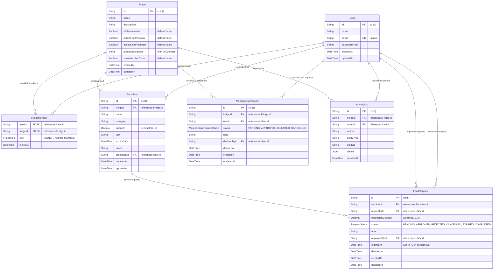
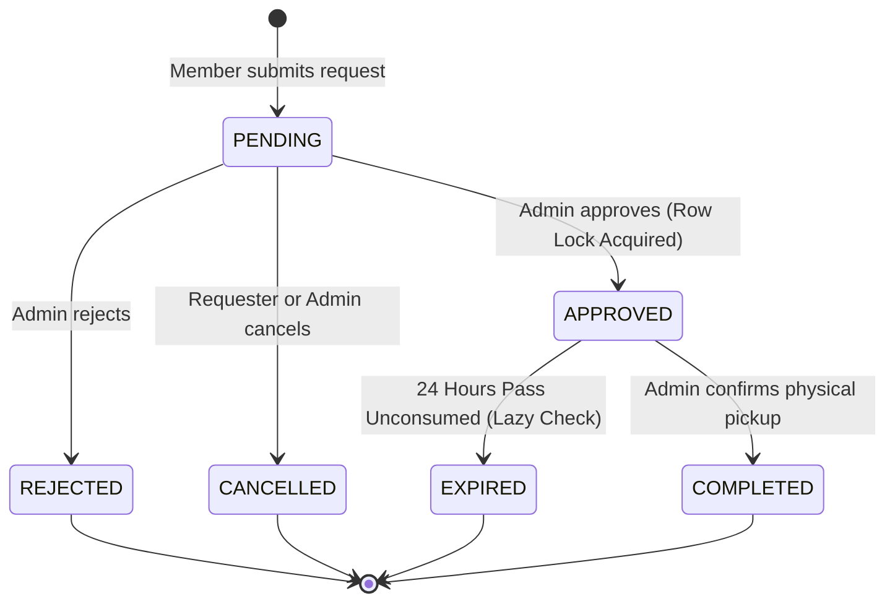

# FridgePolice — Low-Level Design (LLD)

**Project Name:** FridgePolice
**Document Version:** 2.0 (Viva Edition)
**Target Audience:** Students, Viva Examiners, Backend Engineers
**Repository:** [https://github.com/bhavanaaa-1/fridge-police](https://github.com/bhavanaaa-1/fridge-police)

---

## 1. Database Schema & Relational Design

The database uses PostgreSQL 16 hosted on Neon and managed via Prisma ORM (`server/prisma/schema.prisma`).



### 1.1 Database Models Explained

| Model | Purpose | Primary Key | Foreign Keys & Cascades |
| :--- | :--- | :--- | :--- |
| **`User`** | Stores user identity, login credentials, and timestamps. | `id` (CUID) | - |
| **`Fridge`** | Represents an isolated fridge workspace and its privacy settings. | `id` (CUID) | - |
| **`FridgeMember`** | Join table linking users to fridges with a specific role (`OWNER`, `ADMIN`, `MEMBER`). | Composite `[userId, fridgeId]` | `userId` $\to$ `User.id` (`onDelete: Cascade`)<br/>`fridgeId` $\to$ `Fridge.id` (`onDelete: Cascade`) |
| **`FoodItem`** | Individual food inventory records with quantity, unit, and optional expiry date. | `id` (CUID) | `fridgeId` $\to$ `Fridge.id` (`onDelete: Cascade`)<br/>`createdById` $\to$ `User.id` (`onDelete: Restrict`) |
| **`FoodRequest`** | State-tracked requests for food portions. Belongs directly to `FoodItem` and `User`. Scoped to a fridge via `FoodItem.fridgeId`. | `id` (CUID) | `foodItemId` $\to$ `FoodItem.id` (`onDelete: Cascade`)<br/>`requesterId` $\to$ `User.id` (`onDelete: Cascade`)<br/>`approvedById` $\to$ `User.id` (`onDelete: SetNull`) |
| **`MembershipRequest`** | Requests from users wanting to join an open fridge. | `id` (CUID) | `fridgeId` $\to$ `Fridge.id` (`onDelete: Cascade`)<br/>`userId` $\to$ `User.id` (`onDelete: Cascade`)<br/>`decidedById` $\to$ `User.id` (`onDelete: SetNull`) |
| **`ActivityLog`** | Chronological audit logs of actions taken within a fridge. | `id` (CUID) | `fridgeId` $\to$ `Fridge.id` (`onDelete: Cascade`)<br/>`actorId` $\to$ `User.id` (`onDelete: SetNull`) |

---

## 2. API Endpoints Reference

All API routes live under the `/api` prefix:

### 2.1 Authentication Routes (`server/src/routes/auth.routes.js`)

| Method | Endpoint | Auth Required | Role Required | Request Body | Success Response | Status Codes |
| :--- | :--- | :--- | :--- | :--- | :--- | :--- |
| `POST` | `/api/auth/register` | None | None | `{ name, email, password }` | `{ success: true, user: { id, name, email } }` | `201`, `400`, `409` |
| `POST` | `/api/auth/login` | None | None | `{ email, password }` | `{ success: true, token, user }` | `200`, `400`, `401` |
| `GET` | `/api/auth/me` | Bearer JWT | None | None | `{ success: true, user }` | `200`, `401` |

### 2.2 Fridge Routes (`server/src/routes/fridge.routes.js`)

| Method | Endpoint | Auth Required | Role Required | Description | Status Codes |
| :--- | :--- | :--- | :--- | :--- | :--- |
| `POST` | `/api/fridges` | Bearer JWT | None | Creates a new fridge; caller becomes `OWNER`. | `201`, `400`, `401` |
| `GET` | `/api/fridges` | Bearer JWT | None | Lists all fridges the user belongs to. | `200`, `401` |
| `GET` | `/api/fridges/:fridgeId` | Bearer JWT | `MEMBER`, `ADMIN`, `OWNER` | Gets single fridge details. | `200`, `401`, `403`, `404` |
| `PATCH` | `/api/fridges/:fridgeId/settings`| Bearer JWT | `ADMIN`, `OWNER` | Updates fridge privacy and settings. | `200`, `400`, `401`, `403` |
| `GET` | `/api/fridges/:fridgeId/members` | Bearer JWT | `MEMBER`, `ADMIN`, `OWNER` | Lists enrolled fridge members. | `200`, `401`, `403` |
| `POST` | `/api/fridges/:fridgeId/members` | Bearer JWT | `OWNER` | Adds member directly by email. | `201`, `400`, `401`, `403`, `404` |
| `GET` | `/api/fridges/:fridgeId/activity`| Bearer JWT | `MEMBER`, `ADMIN`, `OWNER` | Returns paginated activity log. | `200`, `400`, `401`, `403` |
| `POST` | `/api/fridges/:fridgeId/join-requests` | Bearer JWT | Any logged-in user | Submits request to join fridge. | `201`, `400`, `401`, `409` |
| `GET` | `/api/fridges/:fridgeId/join-requests` | Bearer JWT | `ADMIN`, `OWNER` | Lists incoming join requests. | `200`, `401`, `403` |
| `PATCH` | `/api/fridges/:fridgeId/join-requests/:requestId/approve` | Bearer JWT | `ADMIN`, `OWNER` | Approves join request, creates member. | `200`, `401`, `403` |
| `PATCH` | `/api/fridges/:fridgeId/join-requests/:requestId/reject` | Bearer JWT | `ADMIN`, `OWNER` | Rejects join request. | `200`, `401`, `403` |

### 2.3 Inventory Routes (`server/src/routes/inventory.routes.js`)

| Method | Endpoint | Auth Required | Role Required | Description | Status Codes |
| :--- | :--- | :--- | :--- | :--- | :--- |
| `GET` | `/api/fridges/:fridgeId/items` | Bearer JWT | `MEMBER`, `ADMIN`, `OWNER` | Lists items with search and category filters. | `200`, `400`, `401`, `403` |
| `GET` | `/api/fridges/:fridgeId/items/:itemId` | Bearer JWT | `MEMBER`, `ADMIN`, `OWNER` | Retrieves single food item details. | `200`, `401`, `403`, `404` |
| `POST` | `/api/fridges/:fridgeId/items` | Bearer JWT | `ADMIN`, `OWNER` | Adds new food item to inventory. | `201`, `400`, `401`, `403` |
| `PATCH` | `/api/fridges/:fridgeId/items/:itemId` | Bearer JWT | `ADMIN`, `OWNER` | Reconciles quantity or edits item. | `200`, `400`, `401`, `403`, `404` |
| `DELETE` | `/api/fridges/:fridgeId/items/:itemId` | Bearer JWT | `ADMIN`, `OWNER` | Deletes/discards food item. | `200`, `401`, `403`, `404` |

### 2.4 Food Request Routes (`server/src/routes/request.routes.js`)

| Method | Endpoint | Auth Required | Role Required | Description | Status Codes |
| :--- | :--- | :--- | :--- | :--- | :--- |
| `POST` | `/api/fridges/:fridgeId/requests` | Bearer JWT | `MEMBER`, `ADMIN`, `OWNER` | Requests a portion of food. | `201`, `400`, `401`, `403`, `404` |
| `GET` | `/api/fridges/:fridgeId/requests` | Bearer JWT | `MEMBER`, `ADMIN`, `OWNER` | Lists requests with status filter. | `200`, `400`, `401`, `403` |
| `GET` | `/api/fridges/:fridgeId/requests/:requestId` | Bearer JWT | `MEMBER`, `ADMIN`, `OWNER` | Gets details for a single request. | `200`, `401`, `403`, `404` |
| `PATCH` | `/api/fridges/:fridgeId/requests/:requestId/cancel` | Bearer JWT | Requester or `ADMIN`/`OWNER` | Cancels a pending request. | `200`, `401`, `403`, `404`, `409` |
| `PATCH` | `/api/fridges/:fridgeId/requests/:requestId/approve`| Bearer JWT | `ADMIN`, `OWNER` | Approves request with row lock. | `200`, `401`, `403`, `404`, `409` |
| `PATCH` | `/api/fridges/:fridgeId/requests/:requestId/reject` | Bearer JWT | `ADMIN`, `OWNER` | Rejects a pending request. | `200`, `401`, `403`, `404`, `409` |
| `PATCH` | `/api/fridges/:fridgeId/requests/:requestId/complete`| Bearer JWT | `ADMIN`, `OWNER` | Completes request & reduces stock. | `200`, `401`, `403`, `404`, `409` |

### 2.5 Discovery & User Routes
- `GET /api/discover/fridges`: Public search for discoverable fridges.
- `GET /api/discover/fridges/:fridgeId`: Public view of a single discoverable fridge (food preview if enabled).
- `GET /api/users/me/dashboard`: Summary stats across all user's fridges.
- `GET /api/users/me/requests`: Requests submitted by user and requests awaiting user's review.
- `GET /api/health`: Health probe returning `{"success": true, "message": "FridgePolice API is running!"}`.

---

## 3. Middleware Architecture

The backend request pipeline uses dedicated Express middlewares in `server/src/middleware/`:

### 3.1 Authentication Middleware (`authenticate.js`)
- Reads the `Authorization` header.
- Checks that the format is `Bearer <token>`.
- Calls `verifyToken(token)` using the `JWT_SECRET`.
- Attaches the decoded user ID to `req.user = { id: payload.sub }`.
- Returns `HTTP 401 Unauthorized` if token is missing, expired, or invalid.

### 3.2 Optional Authentication Middleware (`optionalAuthenticate`)
- Used on public endpoints (e.g. `GET /api/discover/fridges/:fridgeId`).
- If a valid token is provided, populates `req.user`. If not, sets `req.user = null` and proceeds without blocking.

### 3.3 Role-Based Authorization Middleware (`authorizeFridge.js`)
- Factory function: `authorizeFridge(["OWNER", "ADMIN"])`.
- Looks up the user's membership in the target fridge from `FridgeMember`.
- If the user is not a member or does not have one of the allowed roles, rejects with `HTTP 403 Forbidden`.
- Attaches the resolved role to `req.fridgeRole` for downstream route handlers.

### 3.4 Centralized Error Handler (`errorHandler.js`)
- Registered last in `server/src/app.js`.
- Automatically formats Zod validation errors into `HTTP 400 Bad Request` with an array of field errors.
- Handles custom HTTP errors via `err.status` or `err.statusCode`.
- Handles unexpected errors by logging the stack trace internally while returning a safe `HTTP 500 Internal server error` to clients.

---

## 4. Input Validation with Zod

All input data is validated before touching the database or running domain logic:

```javascript
// Example from server/src/validators/inventory.validator.js
const positiveQuantity = z
  .number({ invalid_type_error: "Quantity must be a number" })
  .positive("Quantity must be greater than zero");

export const createItemSchema = z.object({
  name: z.string().trim().min(1, "Name is required"),
  category: z.string().trim().min(1).optional(),
  quantity: positiveQuantity,
  unit: z.string().trim().min(1, "Unit is required"),
  expiryDate: z.coerce.date().optional(),
  notes: z.string().trim().optional(),
});
```

- String fields are trimmed automatically.
- Numbers are validated as strictly positive numbers (`> 0`).
- Emails are normalized to lowercase and validated with RFC email format.
- Dates are safely coerced from ISO strings.
- Passwords require a minimum length of 8 characters.

---

## 5. Food Request Lifecycle & Concurrency Locking



### 5.1 Concurrency Locking Implementation (`approveRequest` in `request.service.js`)

When an Admin approves a food request, the system must guarantee that two admins approving different requests at the exact same time do not over-allocate the available food:

```javascript
// In server/src/services/request.service.js
export async function approveRequest(fridgeId, requestId, userId) {
  // 1. Run lazy expiration to sweep away any expired reservations first (on-demand, no cron)
  await expireOverdueReservations(fridgeId);

  const attemptApproval = async () => {
    return prisma.$transaction(
      async (tx) => {
        // 2. Fetch the request
        const request = await tx.foodRequest.findFirst({ ... });
        if (request.status !== "PENDING") {
          throw new Error("Only pending requests can be approved");
        }

        // 3. Acquire exclusive row lock on the target FoodItem
        // Blocks conflicting updates, deletes, and locks; ordinary SELECT reads still permitted
        await tx.$queryRaw`SELECT id FROM "FoodItem" WHERE id = ${request.foodItemId} FOR UPDATE`;

        // 4. Fetch the locked item's total quantity
        const lockedItem = await tx.foodItem.findUnique({
          where: { id: request.foodItemId },
          select: { quantity: true },
        });

        // 5. Aggregate all active, unexpired approved reservations
        const activeReservations = await tx.foodRequest.findMany({
          where: {
            foodItemId: request.foodItemId,
            status: "APPROVED",
            expiresAt: { gt: new Date() },
            id: { not: requestId },
          },
          select: { requestedQuantity: true },
        });

        const reserved = activeReservations.reduce(
          (sum, r) => sum.plus(r.requestedQuantity),
          new Prisma.Decimal(0)
        );

        // 6. Calculate available stock
        const available = lockedItem.quantity.minus(reserved);

        // 7. Enforce availability
        if (request.requestedQuantity.greaterThan(available)) {
          const error = new Error("Insufficient stock to approve this request");
          error.status = 409;
          throw error;
        }

        // 8. Update request status to APPROVED and start 24h lease
        const updated = await tx.foodRequest.update({
          where: { id: requestId },
          data: {
            status: "APPROVED",
            approvedById: userId,
            decidedAt: new Date(),
            expiresAt: new Date(Date.now() + RESERVATION_DURATION_MS),
          },
        });

        // 9. Write audit record
        await tx.activityLog.create({
          data: {
            fridgeId,
            actorId: userId,
            action: "FOOD_REQUEST_APPROVED",
            entityType: "FoodRequest",
            entityId: requestId,
            details: { requestedQuantity: request.requestedQuantity.toString() },
          },
        });

        return updated;
      },
      { isolationLevel: "Serializable" }
    );
  };

  // 10. Automatically retry up to 3 times on PostgreSQL serialization conflicts
  for (let attempt = 0; attempt < 3; attempt++) {
    try {
      return await attemptApproval();
    } catch (error) {
      if (error?.code === "P2034" && attempt < 2) continue;
      throw error;
    }
  }
}
```

---

## 6. Physical Inventory Reconciliation

When groceries are eaten without using the app, or an egg breaks, or milk spoils, the recorded numbers need to be updated:

1. **Quantity Update (`updateItem` in `inventory.service.js`):**
   - Executed inside `prisma.$transaction`.
   - Modifies `FoodItem.quantity` directly.
   - Emits an `INVENTORY_ITEM_UPDATED` record into `ActivityLog`, noting which fields were changed.
2. **Item Deletion (`deleteItem` in `inventory.service.js`):**
   - Executed inside `prisma.$transaction`.
   - Deletes the `FoodItem` row from the database.
   - Emits an `INVENTORY_ITEM_DELETED` record into `ActivityLog` with the item's name and last known quantity.
