# FridgePolice — Product Requirements Document (PRD)

**Project Name:** FridgePolice
**Document Version:** 2.0 (Viva Edition)
**Target Audience:** Students, Viva Examiners, Project Reviewers
**Live Application:** [https://fridge-police.vercel.app](https://fridge-police.vercel.app)
**Backend API:** [https://fridge-police.onrender.com](https://fridge-police.onrender.com)

---

## 1. Problem Statement

In student hostels, shared flats, and community kitchens, multiple people share a single refrigerator. This shared setup regularly creates everyday conflicts:

1. **Unclear Food Ownership:** People do not know if food left on a shelf is meant for everyone or belongs to an individual.
2. **Double Claiming / Over-allocation:** Two roommates might both decide to take the last portion of milk or eggs at the same time, leaving one person disappointed.
3. **Stale Reservations:** A roommate asks for an item, gets permission, but forgets to eat it. The food sits in the fridge reserved for days and eventually spoils.
4. **Offline Eating & Shelf Drift:** People sometimes grab snacks without updating the app immediately, or food spills. Over time, digital counts stop matching what is physically in the fridge.
5. **Community Fridge Coordination:** Shared community pantries want to share what food they have with neighborhood members without sharing personal phone numbers or private member lists.

---

## 2. Project Objectives

FridgePolice was built to solve these problems through software:
- Give shared living groups a clean digital inventory of what is currently in their fridge.
- Provide a fair, transparent request and approval workflow for sharing portions.
- Prevent two people from claiming more food than physically exists using database-level concurrency control.
- Automatically release approved reservations after 24 hours so forgotten food does not go to waste.
- Allow managers to adjust inventory counts when real-world discrepancies happen, while keeping an audit log of who made the change.
- Enable community discovery of public fridges with safe public previews.

---

## 3. Target Users & User Roles

FridgePolice uses a role-based access control (RBAC) model on a per-fridge basis:

| Role | Who They Are | Permissions in FridgePolice |
| :--- | :--- | :--- |
| **Guest / Public** | Unauthenticated visitor or non-member. | Can view public discoverable fridges and preview items (if enabled). Must log in to submit a join request. |
| **Member (`MEMBER`)** | Regular roommate or flatmate. | Can view inventory, search and filter items, submit food requests, cancel their own pending requests, and view the activity log. |
| **Admin (`ADMIN`)** | Trusted flatmate or pantry manager. | All Member permissions plus: add new food items, update or delete items, approve or reject requests, complete consumptions, approve join requests, and update fridge settings. |
| **Owner (`OWNER`)** | Creator or primary manager of the fridge. | All Admin permissions plus: add members directly by email, assign user roles (`ADMIN` or `MEMBER`), and full ownership of the fridge workspace. |

---

## 4. Functional Requirements

### 4.1 Authentication & User Management
- **FR-01 (Registration):** New users register with a name, valid email address, and a password of at least 8 characters. The endpoint returns the created user record (`HTTP 201`).
- **FR-02 (Duplicate Prevention):** Registering with an existing email returns `HTTP 409 Conflict`.
- **FR-03 (Password Security):** Passwords are never stored in plaintext; they are hashed with `bcryptjs` using 10 salt rounds.
- **FR-04 (Login):** Existing users log in with email and password. On success, the server returns an HTTP 200 response with a signed JSON Web Token (JWT) and user profile.
- **FR-05 (Protected Routes):** Protected API endpoints require a `Bearer <token>` in the `Authorization` header. Invalid or missing tokens return `HTTP 401 Unauthorized`.
- **FR-06 (Current User Profile):** The `/api/auth/me` endpoint returns the logged-in user's profile and active fridge memberships.

### 4.2 Fridge Workspaces
- **FR-07 (Create Fridge):** Any authenticated user can create a fridge. The creator automatically receives the `OWNER` role.
- **FR-08 (Multiple Fridges):** A user can belong to multiple fridges and switch between them in the UI.
- **FR-09 (Fridge Settings):** Owners and Admins can update settings:
  - `isDiscoverable` (boolean): Show fridge in public discovery directory.
  - `publicFoodPreview` (boolean): Allow public visitors to see item names.
  - `acceptJoinRequests` (boolean): Allow logged-in non-members to apply to join.
  - `showMemberCount` (boolean): Show total member count on public cards.
  - `publicDescription` (string, up to 1,000 characters): Public note about the fridge.

### 4.3 Food Inventory Management
- **FR-10 (Add Food Item):** Admins and Owners can add items with:
  - `name` (required string)
  - `category` (optional: Dairy, Produce, Meat, Beverage, Snacks, Condiments, Leftovers, Other)
  - `quantity` (positive decimal number)
  - `unit` (e.g. "liters", "items", "grams")
  - `expiryDate` (optional date)
  - `notes` (optional text)
- **FR-11 (Search & Filter):** Members can search items by case-insensitive name match and filter by category with server-side pagination.
- **FR-12 (Physical Reconciliation):** When items are eaten offline or spill, Admins and Owners can edit the quantity directly (`PATCH /api/fridges/:id/items/:itemId`).
- **FR-13 (Discard / Delete Item):** When items spoil or are thrown away, Admins and Owners can delete them (`DELETE /api/fridges/:id/items/:itemId`).

### 4.4 Food Requests & Reservation Lifecycle
- **FR-14 (Create Request):** Any member can submit a portion request for an available item. The initial status is `PENDING`.
- **FR-15 (Approval & Concurrency Lock):** Admins and Owners can approve pending requests. Approval runs in a serializable transaction with a database row lock (`SELECT ... FOR UPDATE`).
  - This lock blocks concurrent transactions from updating, deleting, or locking the target `FoodItem` row until the transaction completes, while ordinary non-locking `SELECT` queries can still read the row.
  - Available stock is calculated as:
    $$\text{Available} = \text{Total Quantity} - \sum(\text{Active Approved Unexpired Reservations})$$
  - If requested quantity exceeds available stock, the approval is rejected with `HTTP 409 Conflict`.
- **FR-16 (24-Hour Expiration Lease):** When a request is approved, an expiration timestamp is set to 24 hours in the future (`expiresAt = Date.now() + 24 hours`).
- **FR-17 (Lazy Expiration Sweeping):** Stale approved requests older than 24 hours are automatically marked `EXPIRED` on-demand whenever requests are listed, viewed, approved, or completed. Expired requests immediately release their reserved stock. No background cron job or independent scheduler is used.
- **FR-18 (Cancellation):** Requesters can cancel their own pending requests. Admins and Owners can cancel any pending request.
- **FR-19 (Complete Consumption):** When the food is physically collected, an Admin or Owner marks the request `COMPLETED`. The reserved amount is subtracted from the food item's recorded quantity.

### 4.5 Community Discovery & Join Requests
- **FR-20 (Browse Public Fridges):** Users can search public discoverable fridges by name or description (text-based search).
- **FR-21 (Public Data Privacy):** Public views only return safe public fields (fridge name, public description, optional member count, optional food preview). Member names, emails, and private notes are never exposed.
- **FR-22 (Submit Join Request):** An authenticated user can submit a membership request (`POST /api/fridges/:id/join-requests`) with an optional note.
- **FR-23 (Review Join Requests):** Owners and Admins can approve or reject join requests. Approving a request automatically adds the user to the fridge with the `MEMBER` role.

### 4.6 Activity Logs
- **FR-24 (Audit Logging):** Major fridge events (item created, item updated, item deleted, request approved, request rejected, request expired, request completed) create an `ActivityLog` entry inside the same database transaction.
- **FR-25 (Activity Feed):** Members can view a chronological list of recent activity for their fridge.

---

## 5. Non-Functional Requirements

- **Data Consistency:** Inventory numbers must always remain accurate. Concurrency locks prevent two approvals from double-allocating items.
- **Security:** Passwords hashed with bcrypt; protected routes guarded by JWT verification; role checks enforced on every sensitive endpoint.
- **Input Validation:** All incoming data is validated using Zod schemas before running business logic.
- **Performance:** Database connection pooling (via Neon PgBouncer) handles multiple concurrent users without connection errors.
- **Error Handling:** Standardized JSON error responses with clear messages and correct HTTP status codes (400, 401, 403, 404, 409, 500).

---

## 6. Core User Workflows

```mermaid
flowchart TD
    subgraph W1 ["Workflow 1: Account & Fridge Setup"]
        A1["User Registers Account"] --> A2["User Logs In (Receives JWT)"]
        A2 --> A3["User Creates Fridge (Becomes OWNER)"]
        A3 --> A4["Owner Adds Roommates via Email"]
    end

    subgraph W2 ["Workflow 2: Food Request & Consumption"]
        B1["Member Views Inventory"] --> B2["Member Requests 1L Milk"]
        B2 --> B3["Request Saved as PENDING"]
        B3 --> B4["Admin Approves Request<br/>(Row Lock Checks Stock)"]
        B4 --> B5["Status = APPROVED<br/>(24h Expiry Timer Starts)"]
        B5 --> B6["Member Consumes Food"]
        B6 --> B7["Admin Marks COMPLETED<br/>(Inventory Decrements)"]
    end

    subgraph W3 ["Workflow 3: Reservation Expiry (Lazy Evaluation)"]
        C1["Approved Request Not Consumed"] --> C2["24 Hours Pass"]
        C2 --> C3["Next API Query Runs Lazy Check"]
        C3 --> C4["Request Marked EXPIRED<br/>(Stock Automatically Freed)"]
    end

    subgraph W4 ["Workflow 4: Physical Shelf Reconciliation"]
        D1["Item Eaten Offline or Spills"] --> D2["Admin Checks Real Shelf"]
        D2 --> D3["Admin Updates Quantity in App"]
        D3 --> D4["Activity Log Records Adjustment"]
    end
```

---

## 7. Scope & Limitations

### In Scope (Implemented in Current Project)
- Complete JWT authentication with bcrypt password hashing.
- Multi-fridge workspaces with per-fridge role-based access (`OWNER`, `ADMIN`, `MEMBER`).
- Decimal quantity tracking, categories, expiration dates, and storage notes.
- Food portion requests with serializable row locking to prevent over-allocation.
- Automatic 24-hour reservation expiry via lazy evaluation.
- Direct inventory reconciliation and discard workflows with activity logs.
- Public community discovery and authenticated join requests.
- Responsive React interface with dark mode and client-side form validation.
- Automated testing suite with 81 test declarations across 6 test suites.

### Out of Scope (Explicitly Not Implemented)
- No mobile apps (responsive web only).
- No barcode scanning or image recognition.
- No hardware smart-scale sensors or door sensors.
- No geolocation / GPS-based "find near me" radius search (discovery uses text search).
- No payment processing or money splitting.
- No push notifications via SMS or WebSockets.
