# FridgePolice — Product Requirements Document (PRD)

**Project Name:** FridgePolice  
**Document Version:** 1.0.0  
**Target Audience:** Kalvium Project Assessors, Engineering Teams, Future Maintainers  
**Repository:** [https://github.com/bhavanaaa-1/fridge-police](https://github.com/bhavanaaa-1/fridge-police)  
**Live Frontend:** [https://fridge-police.vercel.app](https://fridge-police.vercel.app)  
**Live Backend:** [https://fridge-police.onrender.com](https://fridge-police.onrender.com)  

---

## 1. Product Overview

FridgePolice is an intelligent, multi-tenant inventory management and food governance platform designed for shared living spaces (dormitories, shared apartments, co-living households) and community food initiatives (community fridges, food pantries, workplace breakrooms).

The platform addresses the classic "tragedy of the commons" in communal refrigeration: food theft, double-consumption conflicts, forgotten leftovers resulting in spoilage, ambiguity around ownership and sharing permissions, and discrepancies between what is recorded digitally and what physically sits on refrigerator shelves.

FridgePolice empowers roommates and community members to track perishable stock, negotiate portion sharing through formal requests and approvals, prevent accidental over-allocation through database-level transactional concurrency control, and maintain an immutable audit trail of all fridge events.

---

## 2. Problem Statement

Living in shared housing or managing a community pantry frequently leads to interpersonal friction, food waste, and logistical chaos due to the following pain points:

1. **The Tragedy of the Shared Refrigerator:** When food ownership and permissions are ambiguous, roommates either avoid eating items that might be shared or consume items belonging to others without consent.
2. **Double-Allocation Collisions:** In digital sharing environments, if two people simultaneously claim the final portion of food (e.g., the last slice of pizza or remaining carton of milk), naive systems permit both claims, leaving one person disappointed and creating distrust.
3. **Ghost Reservations & Food Hoarding:** A user may request and receive approval for an item but never actually consume it. Without automated reservation expiration, that food remains locked in perpetuity until it spoils.
4. **The "Phantom Eater" / Offline Consumption Discrepancy:** Food is frequently eaten directly from the fridge without immediate smartphone logging, or spills occur, or items spoil and get discarded. If the system cannot gracefully reconcile physical shelf realities with digital records, the digital inventory quickly becomes fiction.
5. **Lack of Privacy Controls for Community Pantries:** Community fridges need to announce their presence and accept join requests without exposing internal member lists, sensitive user contact details, or private notes to unauthenticated visitors.

---

## 3. Product Vision

To create a transparent, reliable, and conflict-free communal food sharing experience. FridgePolice serves as an impartial digital mediator—enforcing fair sharing rules, protecting food reservations with financial-grade transactional safety, and bridging the gap between digital tracking and physical reality with intuitive reconciliation workflows.

---

## 4. Target Users and User Roles

FridgePolice supports a multi-tier role-based access control (RBAC) model operating on a per-fridge basis:

| Role | Definition | Typical User | Key Responsibilities & Permissions |
| :--- | :--- | :--- | :--- |
| **Guest / Public Visitor** | Unauthenticated user or non-member browsing public resources. | Prospective roommate, neighborhood resident looking for food pantries. | Can discover public fridges; view basic metadata (name, public description); view public food previews if enabled; submit membership join requests. |
| **Fridge Member (`MEMBER`)** | Authenticated user granted standard access to a specific fridge. | Roommate, flatmate, community volunteer. | Can view inventory; search/filter items; submit food portion requests for available stock; cancel their own pending requests; view activity logs. |
| **Fridge Administrator (`ADMIN`)** | Authenticated member with elevated managerial permissions. | Senior roommate, community pantry organizer. | All Member capabilities plus: add new food items; update item quantities/details; delete items (physical reconciliation); approve/reject food requests; complete consumption on behalf of members; approve/reject join requests; update fridge discoverability settings. |
| **Fridge Owner (`OWNER`)** | Creator or primary custodian of the fridge workspace. | Leaseholder, homeowner, head of community pantry. | All Admin capabilities plus: add members directly by user ID/email; assign roles; update all fridge configurations; ultimate administrative authority over the fridge workspace. |

---

## 5. User Needs and Use Cases

### 5.1 User Accounts & Authentication
- **UC-01 (Register):** A new user creates an account with a display name, valid email address, and strong password (minimum 8 characters).
- **UC-02 (Login):** An existing user authenticates with email and password to receive a secure JSON Web Token (JWT) valid for session operations.
- **UC-03 (Session Persistence):** The user's active session is securely preserved across browser refreshes via client storage without leaking credentials.

### 5.2 Multi-Fridge Management
- **UC-04 (Create Fridge):** A user creates a new fridge workspace (e.g., "Apartment 4B Fridge" or "Downtown Community Pantry"), automatically becoming its `OWNER`.
- **UC-05 (Switch Fridge):** A user who belongs to multiple fridges (e.g., home fridge, office pantry) can easily switch contexts.
- **UC-06 (Configure Settings):** Owners and Admins toggle discoverability, public previews, join request permissions, and public descriptions.

### 5.3 Inventory Management & Physical Reconciliation
- **UC-07 (Add Food Item):** Admins/Owners record newly purchased groceries specifying item name, category (Dairy, Produce, Meat, Bakery, Beverage, Snack, Other), quantity (up to 2 decimal places), unit (pcs, g, kg, ml, L, slices, cups), optional expiration date, and storage notes.
- **UC-08 (Search & Filter):** Members quickly locate ingredients using case-insensitive search and category filters.
- **UC-09 (Reconcile Discrepancy / Edit Item):** Admins/Owners adjust quantities downward or upward when physical checks reveal real-world differences (spoilage, offline consumption, package size errors).
- **UC-10 (Discard / Delete Item):** Admins/Owners remove rotten or empty items, generating a deletion audit log.

### 5.4 Food Sharing & Transactional Requests
- **UC-11 (Request Food Portion):** A member submits a request for a specific quantity of an available item, optionally attaching a note (e.g., "Making dinner tonight, can I have 2 eggs?").
- **UC-12 (Approve Request):** An Admin/Owner approves the request. The system verifies that the requested quantity plus any other active reservations does not exceed physical stock, placing a 24-hour reservation hold.
- **UC-13 (Reject / Cancel Request):** Admins/Owners reject unfulfillable requests; requesters can cancel their own pending requests prior to approval.
- **UC-14 (Auto-Expiry / Spoilage Release):** If an approved reservation is not consumed within 24 hours, the system automatically transitions the status to `EXPIRED`, immediately restoring available inventory for others.
- **UC-15 (Complete Consumption):** Once the user physically consumes or claims the food, an Admin/Owner marks the request `COMPLETED`, which formally deducts the reserved quantity from the food item's recorded stock.

### 5.5 Community Discovery & Membership Onboarding
- **UC-16 (Discover Fridges):** Users search discoverable fridges without needing an invite link.
- **UC-17 (Request to Join):** Users submit a join request with an optional note explaining why they want to join.
- **UC-18 (Manage Join Requests):** Owners/Admins approve or decline incoming membership requests.

### 5.6 Auditability & Activity Feed
- **UC-19 (Activity Feed):** Members review chronological, non-repudiable logs of item creation, updates, deletions, requests, approvals, rejections, expirations, and consumptions.

---

## 6. Functional Requirements

### 6.1 Authentication & User Management
- **FR-AUTH-01:** System must validate email syntax using standardized RFC-compliant validation and normalize email input to lowercase.
- **FR-AUTH-02:** System must enforce minimum password complexity (at least 8 characters).
- **FR-AUTH-03:** System must hash passwords using `bcrypt` with a minimum salt work factor of 10 prior to storage.
- **FR-AUTH-04:** System must issue signed JSON Web Tokens (JWT) using the `HS256` algorithm containing user identifier claims (`sub`) and expiration periods (`1d`).
- **FR-AUTH-05:** System must reject requests lacking valid Bearer tokens for all protected endpoints with HTTP 401 Unauthorized.
- **FR-AUTH-06:** System must provide a `/api/auth/me` endpoint to return the authenticated user's profile and active memberships.

### 6.2 Fridge Management & Settings
- **FR-FRIDGE-01:** Any authenticated user can create a fridge. The creator is atomically granted the `OWNER` role.
- **FR-FRIDGE-02:** System must allow Owners and Admins to modify fridge settings:
  - `isDiscoverable` (boolean): Controls visibility in public discovery.
  - `publicFoodPreview` (boolean): Controls whether non-members can preview item names in discovery.
  - `acceptJoinRequests` (boolean): Controls whether non-members can submit join applications.
  - `showMemberCount` (boolean): Controls whether aggregate member numbers are revealed publicly.
  - `publicDescription` (string, max 500 characters): Public-facing summary.
- **FR-FRIDGE-03:** System must strictly forbid non-members from reading private fridge inventory, requests, or internal member lists.

### 6.3 Inventory Management
- **FR-INV-01:** Only users with `OWNER` or `ADMIN` roles in a given fridge can create, update, or delete food items.
- **FR-INV-02:** System must store quantities as high-precision decimals (`Decimal(10, 2)`) to eliminate floating-point rounding errors on fractional portions (e.g., 0.5 kg, 1.25 L).
- **FR-INV-03:** System must assign each food item a globally unique CUID identifier (`id`). Items with identical names (e.g., two distinct cartons of "Whole Milk") must remain separate database records with independent quantities, expiry dates, and IDs.
- **FR-INV-04:** System must support server-side case-insensitive text search and category filtering with deterministic pagination (`page`, `limit`).
- **FR-INV-05:** Updating or deleting an item must record an atomic `ActivityLog` entry.

### 6.4 Food Request & Reservation Lifecycle
- **FR-REQ-01:** Any fridge member (`MEMBER`, `ADMIN`, `OWNER`) can submit a `FoodRequest` for items in their fridge.
- **FR-REQ-02:** The system must validate that the requested quantity is strictly greater than 0 and does not exceed the item's total recorded stock.
- **FR-REQ-03:** Approval of a request requires `OWNER` or `ADMIN` privileges.
- **FR-REQ-04 (Double-Allocation Prevention):** During approval, the system must execute inside a database transaction with `Serializable` isolation and acquire an exclusive row lock (`SELECT ... FOR UPDATE`) on the target `FoodItem`. It must calculate:
  $$\text{Available Stock} = \text{Total Quantity} - \sum(\text{Active Approved Unexpired Reservations})$$
  If $\text{Requested Quantity} > \text{Available Stock}$, approval must be rejected with HTTP 409 Conflict.
- **FR-REQ-05 (Reservation Expiry):** Approved requests must automatically be assigned an expiration timestamp set to $24 \text{ hours}$ (`createdAt + 86400000 ms`).
- **FR-REQ-06 (Lazy Expiration Execution):** Whenever requests are listed, retrieved, approved, or completed, overdue approved requests ($\text{expiresAt} \le \text{now}$) must be transitioned to `EXPIRED`, immediately liberating reserved capacity.
- **FR-REQ-07 (Consumption Completion):** Completing an approved request requires `OWNER` or `ADMIN` privileges. It must atomically decrement `FoodItem.quantity` by the requested amount and update request status to `COMPLETED`.

### 6.5 Community Discovery & Join Requests
- **FR-DISC-01:** Unauthenticated and authenticated users can query `/api/discover/fridges` to find fridges where `isDiscoverable = true`.
- **FR-DISC-02 (Data Sanitization):** Public discovery projections must strictly redact private fields: internal member identities, member emails, creation user IDs, and private notes.
- **FR-DISC-03:** Eligible users can submit a `MembershipRequest` (`PENDING`). Duplicate pending requests for the same user-fridge pair must be rejected.
- **FR-DISC-04:** Owners and Admins can approve a join request, which atomically inserts a `FridgeMember` record with role `MEMBER` and updates the request status to `APPROVED`.

---

## 7. Non-Functional Requirements

### 7.1 Concurrency & ACID Integrity
- All inventory mutations and request status transitions must execute inside PostgreSQL transactions.
- Concurrency collisions must be guarded using row-level locking (`FOR UPDATE`) and `Serializable` transaction isolation.
- The backend must provide an automatic retry mechanism (up to 3 attempts) when encountering PostgreSQL serialization failures (`P2034`).

### 7.2 Security & Data Protection
- **Transport Security:** All client-server communication must occur over HTTPS (enforced by Vercel and Render).
- **Security Headers:** The Express API must enforce defensive HTTP headers: `X-Content-Type-Options: nosniff`, `X-Frame-Options: DENY`, `Referrer-Policy: no-referrer`.
- **Payload Limits:** JSON payload parsing must be constrained to 10 KB to prevent memory exhaustion DoS attacks.
- **Credential Protection:** Secrets (`JWT_SECRET`, database connection credentials) must never be committed to source code or logged in error traces.

### 7.3 Performance & Scalability
- **Database Connection Pooling:** Runtime database traffic must utilize Neon's serverless connection pooler (PgBouncer) via `DATABASE_URL` to handle bursty concurrent connections without exhausting database socket limits.
- **Direct Migration Channel:** Schema migrations must utilize direct unpooled connections (`DATABASE_URL_UNPOOLED`) to support transaction-level DDL locks.
- **Index Optimization:** Indexes must be maintained on all foreign keys (`fridgeId`, `createdById`, `foodItemId`, `requesterId`), query filters (`status`, `isDiscoverable`), and temporal sorting columns (`createdAt`).

### 7.4 Maintainability & Code Quality
- Clear separation of concerns: Routes $\to$ Validation Middleware $\to$ Controllers $\to$ Services $\to$ Prisma ORM.
- 100% automated test coverage of critical paths: authentication, inventory CRUD, concurrent approvals, 24-hour reservation expiration, and security boundaries.

---

## 8. User Journeys

```mermaid
flowchart TD
    subgraph Journey1 ["Journey 1: Onboarding & Setup"]
        A1["Register Account with Email/Password"] --> A2["Create 'Apartment 3B' Fridge Workspace"]
        A2 --> A3["Invite / Add Roommates with Roles"]
    end

    subgraph Journey2 ["Journey 2: Stocking Inventory"]
        B1["Purchase Groceries"] --> B2["Add Item (Name, Quantity, Unit, Expiry)"]
        B2 --> B3["Item Listed in Live Inventory"]
    end

    subgraph Journey3 ["Journey 3: Food Request & Consumption"]
        C1["Member Requests 1L Milk"] --> C2["Admin/Owner Approves (Row Lock Acquired)"]
        C2 --> C3["24-Hour Reservation Hold Active"]
        C3 --> C4["Member Consumes Food"]
        C4 --> C5["Admin Completes Request"]
        C5 --> C6["Inventory Auto-Decremented"]
    end

    subgraph Journey4 ["Journey 4: Reconciliation & Offline Drift"]
        D1["Item Spills or Eaten Offline"] --> D2["Admin Audits Physical Refrigerator"]
        D2 --> D3["Admin Reconciles Quantity (PATCH /items)"]
        D3 --> D4["Activity Log Records Adjustment Audit"]
    end
```

---

## 9. Feature Scope

### In-Scope (Implemented & Deployed)
- Complete JWT-based authentication with bcrypt hashing.
- Multi-fridge architecture with per-fridge RBAC (`OWNER`, `ADMIN`, `MEMBER`).
- Full food inventory CRUD with high-precision decimal quantities, units, and categories.
- Real-time inventory search and category filtering with pagination.
- Food reservation workflow with serializable locking, anti-double-booking checks, and 24-hour lazy auto-expiration.
- Explicit consumption completion updating inventory balances.
- Physical discrepancy reconciliation and item deletion with comprehensive audit logging.
- Public community fridge discovery with privacy-preserving projections and join requests.
- Dark mode, responsive design, and intuitive Stitch UI integration.

### Explicitly Out-of-Scope (Future Roadmap)
- Barcode/UPC scanning via camera or external scanner.
- Hardware IoT sensors (smart scales, RFID tags, internal door-open sensors).
- Push notifications via WebSockets, APNs, or SMS (currently relies on real-time polling / refreshes).
- Financial monetization, paid micro-transactions, or grocery delivery integrations.

---

## 10. Acceptance Criteria

1. **Authentication:** A user cannot register with an invalid email or a password under 8 characters. Unauthenticated requests to protected endpoints return HTTP 401.
2. **Access Control:** A `MEMBER` cannot delete an inventory item or approve a food request; attempting to do so returns HTTP 403.
3. **Double-Allocation Proof:** If 2 units of an item remain, and two members concurrently submit and attempt to approve requests for 2 units each, exactly one approval must succeed and the other must fail with HTTP 409.
4. **Reservation Expiry:** An approved request older than 24 hours must be marked `EXPIRED` upon the next query, releasing reserved units back to available stock.
5. **Audit Trails:** Every food creation, update, deletion, request approval, and consumption must produce an immutable record in `ActivityLog`.
6. **Data Privacy:** Querying `/api/discover/fridges` must never return user email addresses or internal membership arrays.
